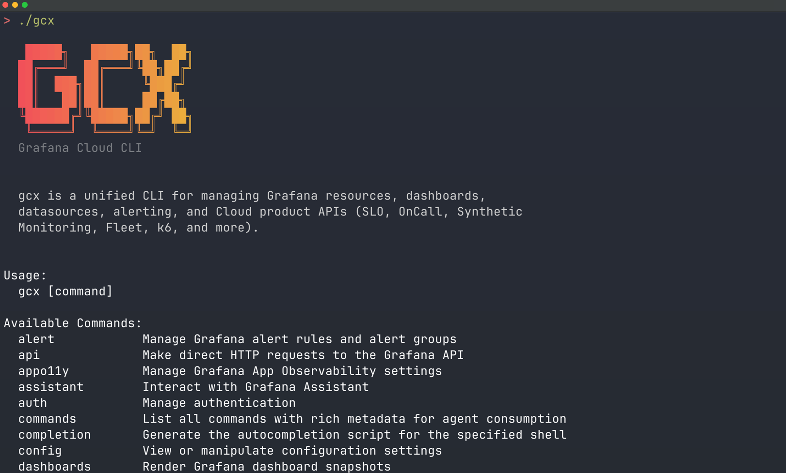
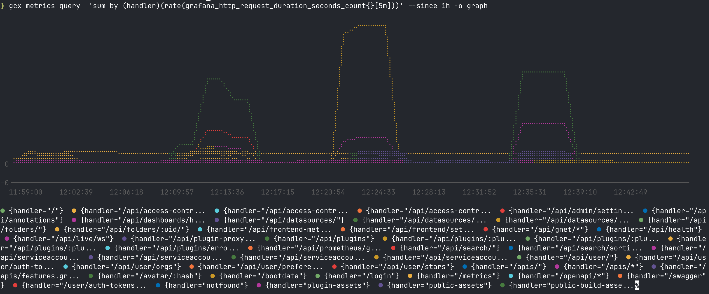

# gcx — Grafana CLI

<p>
<a href="https://github.com/grafana/gcx/actions/workflows/ci.yaml"></a>
<a href="https://go.dev/"></a>
<a href="LICENSE"></a>

</p>



**`gcx` is Grafana in your terminal and your agentic coding environment.** 

With `gcx` you don't guess, but check the actual data. You can query production, investigate alerts, let the Assistant root-cause issues, or ship fixes with Observability built in, without ever leaving your editor.

## What is `gcx`?

`gcx` is a CLI for Grafana Cloud, Enterprise, and OSS alike. It gives you and your AI coding agent structured access to your Grafana deployment's dashboards, alerts, SLOs, metrics, logs, traces, and more. Core features (resources, alerting, signal queries) work on Grafana 12 or higher, while Grafana Cloud adds product-specific commands on top. Refer to the [compatibility matrix](#compatibility-and-availability) for details on supported features.

`gcx` works with any agentic coding tool. It ships with a suite of agent skills for common workflows like alert investigation, dashboard creation and GitOps, SLO management, and observability setup. Refer to [Use with your AI agent](#use-with-your-ai-agent) for further details.

## AI tools: Choose between `gcx`, Grafana MCP, and Grafana Assistant

Grafana offers you a few AI tools to work with.

**`gcx`** gives you and your coding agents access to Grafana through shell commands. Grafana MCP gives AI clients access through Model Context Protocol tools. Grafana Assistant is the Grafana AI agent, built into Grafana. Use `gcx` for terminal work, scripts, GitOps, and CI/CD pipelines. It [supports Grafana OSS, Enterprise, and Cloud](#compatibility-and-availability) and has [dedicated commands for Grafana Cloud products](#supported-grafana-cloud-products).

The **Grafana MCP** is a Model Context Protocol server that gives AI assistants and LLM clients access to your Grafana instance, including clients without shell access. Choose between the [Grafana Cloud MCP](https://grafana.com/docs/grafana-cloud/ai-tools/mcp-servers/cloud-mcp/)(Grafana hosts the server) or the [Grafana OSS MCP](https://grafana.com/docs/grafana/latest/developer-resources/mcp/)(You run and configure the server). 

Finally, **Grafana Assistant** brings a purpose-built LLM into Grafana. Use it to troubleshoot issues, manage dashboards, and answer product questions in plain language. Some advanced features require the full Grafana Cloud feature set. In self-managed Grafana the Assistant app runs in your own deployment but connects to a Grafana Cloud Assistant backend, with a reduced feature set. Refer to the [Grafana Assistant](https://grafana.com/docs/grafana-cloud/platform/grafana-assistant/) documentation for an overview.

> If your coding agent supports both shell commands and MCP, start with `gcx` for these workflows. Choose MCP when a specific tool or its connection model better meets your needs.

## Compatibility and availability

### Grafana version support

`gcx` supports the current Grafana major version (currently 13.x), plus the previous major version for 3 months after the new one ships. 

| Grafana | Support level |
|---------|---------------|
| **Grafana Cloud** | **Full support.** Everything in this README, including Cloud-only products (SLO, Synthetic Monitoring, IRM, k6, Fleet, Adaptive Telemetry, Assistant). |
| **Grafana 13+** (OSS / Enterprise) | **Full support** of self-hosted features. All app-platform API groups `gcx` relies on are enabled by default. |
| **Grafana 12.x** (OSS / Enterprise) | **Not actively supported.** Most features will still work, but there'll only be patches with security updates. Features built on app-platform API groups that are not yet enabled by default need an explicit [feature toggle](#grafana-12-feature-toggles). |
| **Grafana < 12** | **Not supported.** `gcx` detects the server version and exits with code 6 (version incompatible). |

### Feature availability by deployment

Feature availability depends on your Grafana deployment:

| Feature | Commands | OSS | Enterprise | Cloud | BYOC |
|---------|----------|:---:|:----------:|:-----:|:----:|
| Resource management (dashboards, folders) | `resources` | ✓ | ✓ | ✓ | ✓ |
| Alert rules | `alert` | ✓ (1) | ✓ (1) | ✓ | ✓ |
| Raw API passthrough | `api` | ✓ | ✓ | ✓ | ✓ |
| Observability as Code | `dev` | ✓ | ✓ | ✓ | ✓ |
| Signal queries (metrics, logs, traces, profiles) | `metrics`, `logs`, `traces`, `profiles` | ✓ (2) | ✓ (2) | ✓ | ✓ |
| SLO, Synthetic Monitoring, IRM, k6, Fleet, etc. | `slo`, `synthetic-monitoring`, `irm`, `k6`, `fleet` | ✗ | ✗ | ✓ | (3) |
| Adaptive Metrics / Logs / Traces | `metrics adaptive`, `logs adaptive`, `traces adaptive` | ✗ | ✗ | ✓ | (3) |
| Grafana Assistant | `assistant` | ✗ | ✗ | ✓ | ✗ |

(1) Alert rules (`gcx alert rules`, `gcx alert groups`) and ruler writes (`gcx alert ruler`) managed by data sources work on Grafana 12 or higher. To write Grafana-managed rules via the resources tier (`gcx resources pull/push alertrules`) you need Grafana 13 or higher. If you're using Grafana 12, refer to [Grafana 12 feature toggles](#grafana-12-feature-toggles).

(2) Self-hosted signal queries (`gcx metrics query`, `gcx logs query`, `gcx traces query`, and `gcx profiles query`) work against self-hosted data sources (Prometheus, Loki, Tempo, Pyroscope), but you need to manually configure data source endpoints. In Grafana Cloud, your stack will auto-discover endpoints.

(3) Bring Your Own Cloud runs the Grafana stack on your own infrastructure while connecting to the Grafana Cloud control plane. Core Grafana features (dashboards, alerts, signal queries) work in full. Cloud product availability (SLO, Synthetic Monitoring, IRM, etc.) depends on which plugins you've installed and configured in your BYOC stack.

#### Grafana 12 feature toggles

Grafana is progressively migrating APIs to app-platform (Kubernetes-style) API groups. Each group flips to enabled-by-default in a different release. When a command needs an API group your stack doesn't serve, upgrade or enable the corresponding feature toggle. 

- Track declaration of these requirements (min version, feature toggles) for each command in [#989](https://github.com/grafana/gcx/issues/989).
- [Read more abut the new API model](https://grafana.com/docs/grafana/latest/developer-resources/api-reference/http-api/#new-generation-http-apis).

For example, writing Grafana-managed rules via the resources tier (`gcx resources pull/push alertrules`) requires Grafana 13 or higher, where the `rules.alerting.grafana.app` API is enabled by default. On Grafana 12 you must enable it explicitly with the `kubernetesAlertingRules` feature toggle:

```ini
[feature_toggles]
kubernetesAlertingRules = true
```

This toggle is experimental in 12.x, requires a restart, and Unified Alerting must be enabled.

### Supported Grafana Cloud products

`gcx` provides dedicated commands for each Grafana Cloud product:

| Product | Command | Examples |
|---------|---------|----------|
| **SLOs** | `gcx slo` | `slo definitions list`, `slo reports list` |
| **Synthetic Monitoring** | `gcx synthetic-monitoring` | `synthetic-monitoring checks list`, `synthetic-monitoring probes list`, `synthetic-monitoring probes deploy` |
| **IRM** | `gcx irm` | `irm oncall schedules list`, `irm oncall integrations list`, `irm incidents list`, `irm incidents create -f incident.yaml` |
| **Alerting** | `gcx alert` | `alert rules list`, `alert groups list` |
| **k6 Cloud** | `gcx k6` | `k6 load-tests list`, `k6 runs list` |
| **Fleet Management** | `gcx fleet` | `fleet pipelines list`, `fleet collectors list` |
| **Knowledge Graph** | `gcx kg` | `kg status`, `kg entities list`, `kg entities inspect`, `kg graph query` |
| **Frontend Observability** | `gcx frontend` | `frontend apps list`, `frontend apps get` |
| **App Observability** | `gcx appo11y` | `appo11y overrides get`, `appo11y settings get` |
| **Agent Observability** | `gcx agento11y` | `agento11y conversations list`, `agento11y experiments pull`, `agento11y rules list` |
| **Assistant** | `gcx assistant` | `assistant prompt`, `assistant investigations list`, `assistant mcp-servers list` |
| **Adaptive Metrics** | `gcx metrics adaptive` | `metrics adaptive recommendations list`, `metrics adaptive rules list` |
| **Adaptive Logs** | `gcx logs adaptive` | `logs adaptive patterns list`, `logs adaptive drop-rules list` |
| **Adaptive Traces** | `gcx traces adaptive` | `traces adaptive recommendations list`, `traces adaptive policies list` |
| **Profiles (Pyroscope)** | `gcx profiles` | `profiles query`, `profiles labels` |
| **Traces (Tempo)** | `gcx traces` | `traces query`, `traces get`, `traces labels` |

> **Keep in mind Grafana Cloud costs.** `gcx` itself is free, but some of these products are billed based on usage: Grafana Assistant is charged per token consumed (including requests made through `gcx`), Synthetic Monitoring per test execution, k6 per Virtual User Hour, and IRM per monthly active user. Queries and resource push/pull are not billed. Refer to [Costs and billing](docs/reference/costs.md) and the [Grafana Cloud Cost Management and Billing documentation](https://grafana.com/docs/grafana-cloud/cost-management-and-billing/) for more details.

## New to `gcx` or Grafana? Start here!

### Install `gcx`

> For other installation options such as the binary or Go install, refer to the main [Installation](/docs/sources/installation) doc.

The quickest way to install `gcx` in Linux or macOS is with the script, which downloads the latest release, verifies the SHA-256 checksum, and installs to `~/.local/bin`.

```sh
curl -fsSL https://raw.githubusercontent.com/grafana/gcx/main/scripts/install.sh | sh
```

You can override the location with `GCX_INSTALL_DIR`:

```sh
curl -fsSL https://raw.githubusercontent.com/grafana/gcx/main/scripts/install.sh | GCX_INSTALL_DIR=/usr/local/bin sh
```

To upgrade, run the same command again, then check `gcx --version`. 

#### Homebrew

To install `gcx` using Homebrew in Linux or macOS run: 

```bash
brew install gcx
```

This installs the `gcx` formula from homebrew-core. Homebrew has a prebuilt bottle for macOS and Linux, so the install takes seconds and needs no tap.

To update to the latest version:

```bash
brew update && brew upgrade gcx
```

The Grafana tap also carries `gcx`. Use it if you want Homebrew to compile the binary on your machine, run:

```bash
brew install grafana/grafana/gcx
```

### Access Grafana

If you're new to Grafana Cloud, use `gcx` to create a free account and connect to its first stack when you approve:

```sh
gcx signup
```

Next, log into your account from your terminal or agent: 

```sh
gcx login
``` 

`login` creates or re-authenticates a context. It auto-detects whether the server is Grafana Cloud (`*.grafana.net`) or on-premise and adjusts the prompt accordingly. 

Refer to [Authentication](/docs/sources/authentication) for the available paths and options to authenticate.

## Use with your AI agent

`gcx` is compatible with any AI agent. Agent mode uses known identity signals, including Codex and Gemini CLI. For tools without a native signal, set `GCX_AGENT_NAME` to a supported label. Refer to [agent detection and harness names](docs/design/environment-variables.md#agent-mode-variables) for details.

If you're contributing a new Grafana domain capability to `gcx`, ask your coding agent to use [`contribute`](.agents/skills/contribute/SKILL.md) before choosing a command, provider, or data source path.

### Install agent skills

`gcx` ships a portable agent skills bundle for setup, dashboard creation and GitOps, datasource exploration, alert investigation, structured debugging, SLO management, Synthetic Monitoring workflows, Knowledge Graph diagnosis, project scaffolding, resource generation and import, and end-to-end Observability rollout. 

Read the [full skill inventory](claude-plugin/README.md#skills) in the Claude plugin README, and refer to the [skill lifecycle](claude-plugin/README.md#skill-lifecycle) for the catalog and ownership limits.

**For Claude Code**

Use the dedicated [Claude Code plugin](claude-plugin/README.md):

```text
/plugin marketplace add grafana/gcx
/plugin install gcx@gcx-marketplace
```

**For other `.agents`-compatible harnesses**

For example: OpenAI Codex, OpenCode, and Pi. View the skills shipped in the bundle with:

```sh
gcx agent skills list
```

Install the bundle into `~/.agents/skills` with:

```sh
gcx agent skills install --all
```

### List, update, or remove skills 

To see locally present retired skills and their replacements, run `gcx agent skills list`.

To refresh skills that are already installed, run `gcx agent skills update`. 

Note that `update`: 

- Refreshes skills but doesn't add newly bundled skills. After upgrading `gcx`, install a new skill by name. 
- Warns about deprecated and retired skills, but never deletes retired files or installs replacements automatically. 

To refresh existing skills and add every newly bundled one, run: 

```sh
gcx agent skills update
gcx agent skills install --all 
```

To remove an unwanted skill explicitly, run `gcx agent skills uninstall <skill>`. Retired names remain supported after their
content leaves the bundle. 

### The agentic workflow

Investigation, fix, instrumentation, monitoring — without the developer ever leaving their editor. The Grafana Assistant provides the intelligence; gcx provides the interface. And because it all builds on everything you've already configured in Grafana — your dashboards, your alerts, your datasources — no other tool can give you this depth out of the box.

Here's how your coding agent with access to production investigates alerts with Grafana Assistant and `gcx`: 

**1. An alert fires:** For example, a P95 latency on the checkout service crosses the SLO threshold.

**2. The Assistant investigates:** Your coding agent calls the Grafana Assistant through `gcx`. The Assistant has already started its investigation, and is able to trace the issue to a missing index on `customer_id` causing full table scans under load.

**3. It fixes the issue:** Drafts the migration, and adds the index.

**4. It prevents recurrence:** Instruments the service with OpenTelemetry spans, sets up a Synthetic Monitoring check on the checkout flow, and creates an alert rule on query duration.

**5. It ships!** The Assistant opens a PR, tests pass, deploys to production. The alert resolves.

```sh
$ gcx assistant investigations list
ID    TITLE                                     STATUS     UPDATED
abc1  Checkout P95 latency breach               active     2m ago
def2  Memory leak in payment-svc                resolved   1h ago
```

### More AI workflows

While the alerting example uses the Grafana Assistant, which requires Grafana Cloud, these workflows work on any Grafana setting:

- **Resource GitOps**. Pull writable resource types to local files, let your agent edit them, push back to Grafana (`gcx resources pull` / `gcx resources push`).
- **Explore your data**. Discover datasources, metrics, labels, and log streams before writing queries (`gcx datasources list`, `gcx metrics labels`).
- **Bring Assistant context into your agent**. Read a conversation by ID or a shared Grafana Assistant URL, including AI SDK main-thread transcripts (`gcx assistant conversation get <id-or-url> -o json`).
- **Look up product docs**. Search and read Grafana documentation from the terminal (`gcx docs search`, `gcx docs get`).
- **SLO management**. Create, monitor, and investigate SLOs from your terminal (`gcx slo definitions list`, `gcx slo reports list`).
- **Onboarding & setup**. Instrument a Kubernetes cluster and configure Grafana Cloud products (`gcx instrumentation setup`).
- **Observability as Code**. Scaffold a project, import existing dashboards as Go code, lint, and deploy (`gcx dev scaffold`, `gcx dev import`).

## What can I do with gcx?

Here's a glimpse of what you can do with `gcx`. Refer to the [user guides](./docs/sources/guides/) for extended use cases.

### Query production metrics from your terminal

```sh
$ gcx metrics query  'sum by (handler)(rate(grafana_http_request_duration_seconds_count{}[5m]))' --since 1h -o graph
```



### Query data sources 

To query data sources directly:

```sh
# PromQL queries
gcx metrics query 'rate(http_requests_total[5m])' --since 1h
gcx metrics labels
gcx metrics metadata

# LogQL queries
gcx logs query '{app="nginx"} |= "error"' --since 1h
gcx logs labels
gcx logs series --match '{app="nginx"}'
```

> `gcx` also supports Pyroscope (profiling) and Tempo (traces) data sources.

### Check what's firing

To check alerts:

```sh
$ gcx alert rules list --state firing
┌──────────────────────────────────────┬─────────────────────────────────────────────────────────────────────┬──────────┬──────────┬──────────┐
│ UID                                  │ NAME                                                                │ STATE    │ HEALTH   │ PAUSED   │
├──────────────────────────────────────┼─────────────────────────────────────────────────────────────────────┼──────────┼──────────┼──────────┤
│ e62566b8-da2d-45e0-853a-40abebc9f863 │ adaptive_traces_forecast_gme_distributor_alert                      │ firing   │ ok       │ no       │
│ cfhcfnhd8xam9a                       │ GraphiteProxy: Reads (dev) Native - Error Budget Burn Rate is High  │ firing   │ ok       │ no       │
│ affq1sffre0apd                       │ Unified Storage: HIGH_SLOW Latency - Error Budget Burn Rate is High │ firing   │ ok       │ no       │
│ 16ddf4b0-7d8c-5dad-a71a-81f87a1e47a2 │ BillingSeriesAbsent                                                 │ firing   │ ok       │ no       │
│ 09d44d08-b4cc-5d0e-8544-514e380f6bb3 │ k6CloudSecretsUsageReportingNoData                                  │ firing   │ ok       │ no       │
│ eb62d01f-5f73-543b-947b-2c849890d5f6 │ MissingBackups                                                      │ firing   │ ok       │ no       │
│ 5f9e01d4-0b2d-5b51-a787-26535ded4719 │ MissingBackups                                                      │ firing   │ ok       │ no       │
│ e4646576-9c07-5dfd-b22c-1e5b4da761ef │ MissingBackups                                                      │ firing   │ ok       │ no       │
│ b89d5170-d0bd-5869-ad22-7a0a944b3aae │ MissingBackups                                                      │ firing   │ ok       │ no       │
```

### Review SLO status

```sh
$ gcx slo definitions list
┌───────────────────────┬───────────────────────────────────────────────────────┬─────────────┬────────────┬────────────┐
│ UUID                  │ NAME                                                  │ TARGET      │ WINDOW     │ STATUS     │
├───────────────────────┼───────────────────────────────────────────────────────┼─────────────┼────────────┼────────────┤
│ y5yc8cy86yqtmey930foh │ CB additional identifier                              │ 90.00%      │ 28d        │ created    │
│ sgz23sbv2c19v0r32s8y1 │ Checkout App - p95 Latency                            │ 99.50%      │ 28d        │ updated    │
│ nwd4dk7j38spanror727k │ GraphiteProxy: Reads (dev) Native                     │ 99.50%      │ 28d        │ created    │
│ e1cteeyl2ukmilw1tqugw │ KG fusion test grafana-slo-app                        │ 99.50%      │ 28d        │ created    │
│ bwyf5d8g1614ugri7u0w7 │ KG fusion test grafana-slo-stats-service              │ 99.50%      │ 28d        │ created    │
│ tfkp5e0ronnl1ywpbv9b5 │ OTLPGateway: MetricWrites (dev) - Mimir               │ 99.90%      │ 28d        │ created    │
│ wvgxovr2k60efxizv1y9f │ Unified Storage: HIGH_SLOW Latency                    │ 99.50%      │ 28d        │ updated    │
└───────────────────────┴───────────────────────────────────────────────────────┴─────────────┴────────────┴────────────┘
```

### Manage resources 

Manage both Grafana-native resources (dashboards, folders) and Grafana Cloud resources from a single CLI:

```bash
# Pull dashboards and folders to local files
gcx resources pull dashboards -p ./resources -o yaml
gcx resources pull folders -p ./resources -o yaml

# Push local changes back to Grafana
gcx resources push -p ./resources

# Preview changes without applying
gcx resources push -p ./resources --dry-run

# Validate resources before pushing
gcx resources validate -p ./resources

# Edit a dashboard interactively (opens $EDITOR)
gcx resources edit dashboards/my-dashboard

# Delete a resource
gcx resources delete dashboards/my-dashboard
```

### Synthetic management

Synthetic Monitoring check manifests support optional `spec.folderUid` for folder assignment. Refer to the [Synthetics check management guide](claude-plugin/skills/synth-manage-checks/SKILL.md#step-3-build-yaml-definition) for create/update semantics and cross-stack push guidance.

### Observability as code

`gcx` includes tools for managing Grafana resources as Go code using the [Grafana Foundation SDK](https://grafana.com/docs/grafana/latest/as-code/observability-as-code/foundation-sdk/):

```bash
# Scaffold a new project
gcx dev scaffold --project my-dashboards

# Import existing dashboards from Grafana as Go builder code
gcx dev import dashboards

# Live-reload dev server (preview dashboards in browser)
gcx dev serve ./resources

# Lint resources with built-in and custom Rego rules
gcx dev lint run ./resources
gcx dev lint list-rules                         # list available rules
gcx dev lint new dashboard my-rule              # create custom rule

# Build and push
go run . && gcx resources push -p ./resources
```

### GitOps

Pull resources to files, version in git, then push back:

```bash
# Pull all resources
gcx resources pull -p ./resources -o yaml

# Commit to git
git add ./resources && git commit -m "snapshot Grafana resources"

# Push changes from git to Grafana
gcx resources push -p ./resources
```

`gcx push` is idempotent, so running it multiple times produces the same result. Folders are automatically pushed before dashboards to satisfy dependencies.

Updates preserve the existing `kubectl` manager identity, including identities from `grafanactl` and older `gcx` releases. New resources use the stable identity `gcx`. Refer to [manager metadata](docs/architecture/resource-model.md#manager-metadata).

> **gcx resources push/pull vs Git Sync:** [Git Sync](https://grafana.com/docs/grafana/latest/as-code/observability-as-code/git-sync/) provides bi-directional sync between your git repo and Grafana for dashboards. `gcx resources push/pull` enables users to create their own as-code resource synchronisation workflows. `gcx resources push/pull` also works with all resources available in `gcx resources get`, not just dashboards.

### CI/CD

You can deploy your resources using `gcx`:

```yaml
# .github/workflows/deploy-resources.yaml
name: Deploy Grafana Resources
on:
  push:
    branches: [main]
    paths: ['resources/**']

jobs:
  deploy:
    runs-on: ubuntu-latest
    steps:
      - uses: actions/checkout@v4

      - name: Install gcx
        run: |
          curl -fL "$(curl -s https://api.github.com/repos/grafana/gcx/releases/latest | grep browser_download_url | grep linux_amd64.tar.gz | cut -d '"' -f 4)" | tar xz gcx
          chmod +x gcx && sudo mv gcx /usr/local/bin/

      - name: Deploy resources
        env:
          GRAFANA_SERVER: ${{ secrets.GRAFANA_PROD_URL }}
          GRAFANA_TOKEN: ${{ secrets.GRAFANA_PROD_TOKEN }}
        run: |
          gcx resources validate -p ./resources
          gcx resources push -p ./resources --on-error abort
```

- `gcx resources` commands are designed for non-interactive use, apart from `edit`, which opens an external editor
- `resources delete` has no confirmation prompt. Named selectors proceed without `--force`; a type-only selector such as `dashboards` requires `--force` (`--yes` also enables it) and can delete every matching resource in the selected context and namespace
- `--dry-run` on `push` and `delete` to preview changes
- `--on-error abort|fail|ignore` to control error behavior
- `-o json` or `-o yaml` for machine-parseable output
- `--jq '<expr>' -o agents` for [jq with compact output and spilling](docs/design/output.md#16-jq-transformation)

### Provisioning and UI updates

Contact points, notification policies, templates, and mute timings that `gcx` creates or updates through Grafana's provisioning API remain editable in the Grafana UI by default. 

Pass `--allow-ui-updates=false` to contact-point or mute-timing create and update commands, `alert templates upsert`, or `alert notification-policies set` to use Grafana's default provisioning ownership. Grafana then prevents UI edits to the provisioned item.
To update a provisioned contact point, keep `--allow-ui-updates=false`.

Grafana can reject an attempt to make an existing provisioned contact point editable in the UI because its provenance cannot be changed by that update.

```bash
gcx alert contact-points create -f contact-point.yaml --allow-ui-updates=false
```

### Mobile Frontend Observability apps

Mobile Frontend Observability app manifests set `spec.appType: mobile` and a mobile
`spec.runtime`. Refer to [`gcx frontend apps create`](docs/sources/cli-reference.md#gcx-frontend-apps-create-gcx-frontend-apps-create)
for the runtimes and an example manifest, and
[`gcx frontend apps update`](docs/sources/cli-reference.md#gcx-frontend-apps-update-gcx-frontend-apps-update) for what an update keeps.

### Manage Assistant Watchers (experimental)

Read Watcher configuration with `gcx assistant watchers list` and `get WATCHER`, inspect runtime observations with `status WATCHER`, or export manifests with `gcx resources pull watchers`. Apply configuration with `create -f FILE`, `update WATCHER -f FILE` or `gcx resources push`; remove a Watcher with `delete WATCHER --force`. Creation stays inactive and uncalibrated. Requires Grafana Cloud. See [Assistant Watchers](docs/sources/guides/manage-assistant-watchers).

Pulled Watcher manifests can be pushed back unchanged. Applying configuration preserves calibrated content and learned state; meaningful settings outside the manifest model cause an explicit refusal.

## Raw API access

For anything not covered by built-in commands, use the API passthrough. For example, to work with dashboards:

```bash
# Review who can access a dashboard
gcx api /api/dashboards/uid/my-dashboard/permissions -o yaml

# Star a dashboard for the current user
gcx api /api/user/stars/dashboard/uid/my-dashboard -X POST

# Version history: list versions
gcx api /api/dashboards/uid/my-dashboard/versions -o yaml

# Compare two dashboard JSONs before pushing
gcx api /api/dashboards/calculate-diff -X POST -d @diff-request.json
```

## Usage statistics

`gcx` reports limited usage statistics about itself to Grafana Labs. This data is used to understand which commands and flags are used most, where commands fail, and which commands people try that don’t exist, so we can make the product better.

To find out more about `gcx` usage statistics, or for information on how to disable it, refer to the [Usage and statistics documentation](https://grafana.com/docs/grafana/latest/as-code/observability-as-code/grafana-cli/gcx/anonymous-usage-statistics/).

## Documentation

| Topic | Description |
|-------|-------------|
| [Installation](docs/sources/installation.md) | Install gcx on macOS, Linux, and Windows |
| [Authentication](docs/sources/authentication.md) | Authenticate `gcx` |
| [Configuration](docs/sources/configuration.md) | Contexts, authentication, environment variables |
| [Dashboards as Code](docs/sources/guides/dashboards-as-code.md) | Dashboard-as-code workflow with live dev server |
| [Managing Resources](docs/sources/guides/manage-resources.md) | Get, push, pull, delete, edit, validate |
| [Linting Resources](docs/sources/guides/lint-resources.md) | Lint dashboards and alert rules with Rego policies |
| [CLI Reference](docs/sources/cli-reference.md) | Full command reference (auto-generated) |
| [Engineering RFCs](docs/rfcs/README.md) | Proposals, technical designs, and review workflows |

## Contributing

Read our [contributing guide](CONTRIBUTING.md).

## License

Apache 2.0 [LICENSE](LICENSE).
