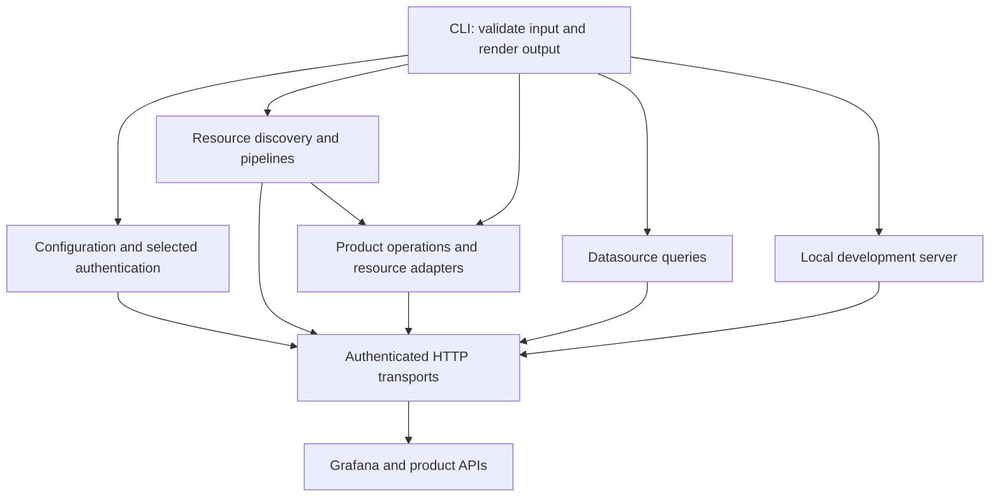

# System Architecture

gcx combines a Kubernetes-compatible resource pipeline with product-specific Grafana APIs. [ARCHITECTURE.md](../../ARCHITECTURE.md) is the entry point; this guide explains how the layers cooperate. [CONSTITUTION.md](../../CONSTITUTION.md) defines the invariants, and [DESIGN.md](../../DESIGN.md) defines the CLI contract.

## Layered Structure

Command factories own flag parsing, validation, user interaction, and output. Domain packages own resource transformations, product operations, and persistence. The main module exposes a CLI rather than a supported public Go API; its implementation lives under `internal/`. The separately versioned [sandbox module](../../experimental/sandbox/README.md) is the embedding boundary.

## Resource Model and Routing

`Resource` combines an unstructured Kubernetes object, Grafana metadata accessors, and source information. Retaining the source path and format enables pull/edit round trips and local save-back. `Resources` deduplicates objects by GVK and name.

Selectors are parsed without I/O. Discovery resolves their partial names into descriptors and filters that carry the API group, version, kind, and resource name. Runtime discovery lets newly available native resource kinds work without a new gcx release.

The resource client router dispatches registered GVKs to provider adapters and otherwise uses Grafana's Kubernetes-compatible API. Providers supply typed registrations through their single registration call; factories create clients lazily. Native `/apis` resources remain on the dynamic-client path even when dedicated product commands expose them.

See [resource model](resource-model.md) for identity, schema, discovery, registration, and routing contracts, and [patterns](patterns.md) for adapter and native-binding conventions.

## Request Flow

```mermaid
flowchart LR
    Input[Arguments and flags] --> Validate[Validate without I/O]
    Validate --> Config[Load selected context]
    Config --> Resolve[Resolve selectors through discovery]
    Resolve --> Read[Read and filter local resources]
    Read --> Push[Schedule folders by level, then other resources]
    Push --> Process[Apply ordered processors per resource]
    Process --> Route[Route to native client or provider adapter]
    Route --> Mutate[Create or update]
    Mutate --> Result[Render results and failures]
```

Push uses Get/Create-or-Update reconciliation and preserves destination update metadata. It must finish parent folders before their children and finish folders before other resources. Pull strips server-owned fields and writes portable manifests; delete relies on callers to apply ownership filters. Dry-run safety and server-derived names need additional policies beyond basic Kubernetes request options.

The development server keeps local resources in memory, intercepts resource requests, proxies other traffic to Grafana, and reloads browsers on file changes. Datasource queries use a separate request/response model rather than resource envelopes.

See [data flows](data-flows.md) for mutation guards, identity matching, read-only handling, partial failures, local I/O, and live reload. Batch results carry an operation summary even when work partially fails; callers must inspect the summary as well as the returned error. Cancellation and concurrency limits apply at the relevant pipeline layer, independently of HTTP rate limiting.

## Configuration and Authentication

Contexts bind a stack, an optional Cloud credential entry, and datasource defaults. Stack and Cloud entries merge atomically across configuration layers; context reference/default fields may merge. Process-local environment overrides affect the selected resolved view and must not be flattened into stored configuration.

Authentication selection is authoritative: clients share the effective method and TLS view rather than independently choosing among populated credential fields. OAuth refresh coordinates cross-process locking, token reload, and persistence. Keychain references bind secrets to their source, owner, field, and destination; native-keychain failures fail closed unless the user explicitly opts out.

See [configuration](config-system.md), [authentication](auth-system.md), and [login orchestration](login-system.md) for loading, mutation, credential, and retry contracts.

## API Boundaries

| Path | Responsibility |
|---|---|
| Kubernetes dynamic client | Native resource discovery and CRUD, including namespace and version handling |
| Grafana OpenAPI client | Grafana-specific legacy API operations such as health/version probing |
| Datasource HTTP clients | Query construction and response conversion using the selected Grafana transport |
| Product clients and adapters | Product-specific APIs and conversion to resource envelopes where reconciliation applies |

Using Kubernetes client libraries avoids duplicating discovery, pagination, and API error machinery at the cost of a substantial dependency graph. Direct query clients bypass that machinery while reusing authentication. Unified datasource-query requests share transport and data-frame types instead of duplicating fallback and response-limit logic.

See [client/API layer](client-api-layer.md) for transport construction and error translation, [CLI layer](cli-layer.md) for command lifecycle and output, and [project structure](project-structure.md) for module and build boundaries.
