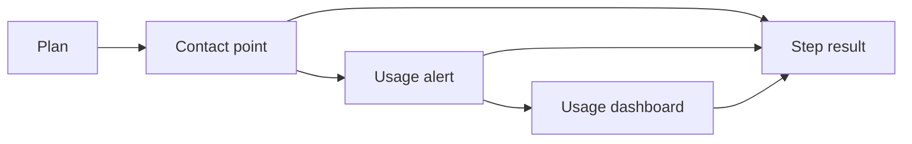

# Setup quickstart

`gcx setup quickstart` is a first-run starter kit on the current Grafana context. After login, one command creates a small set of real objects and prints what each step did.

```
gcx setup quickstart --use-defaults --email you@example.com
gcx setup quickstart --use-defaults --email you@example.com --dashboard=false
```

## What it does

The command resolves a plan, then runs three steps. Each step is independent. A failure is recorded and the rest still run. Running it again is safe: an object that already has the quickstart name is left as it is.



A TTY can prompt. Anywhere else, including agent mode, the caller passes `--use-defaults` and the inputs up front. Any step can be turned off with a flag.

## What lands in the stack

| Step | Name | Where it goes |
|------|------|----------------|
| Email contact point | `quickstart-email` | Alerting contact points |
| Folder + alert rule | folder `gcx quickstart`, rule `quickstart-usage` | Alerting → Alert rules |
| Dashboard | `quickstart-usage-dashboard` | Dashboards, in the same folder |

The alert and the dashboard both watch `sum(grafanacloud_instance_active_series)` on the built-in billing datasource. The alert routes to the contact point. The dashboard is one time series of that same query. Nothing in the command is billed on its own, and nothing asks for a URL.

The command writes into the stack. It does not write local files.

## How it is put together

Quickstart does not invent new product APIs. It calls the ones gcx already uses:

- Contact points go through the alerting provisioning API.
- The folder, the alert rule, and the dashboard go through Grafana's app APIs (`folder.grafana.app`, `rules.alerting.grafana.app`, `dashboard.grafana.app`). The rule and the dashboard have to name a folder or Grafana rejects them.

The result is one document, `gcx.setup.quickstart.result`, with a step, an action (`created`, `exists`, `skipped`, `failed`), and a reference. Text output is a table of that document. JSON is the same document.

## Extending it

A new starter is another step with the same four outcomes. The step owns its product client and its stable name. The runner only sequences steps and collects the result.

Likely next steps, if we want them: an SLO, a notification route. Each one is a product decision about defaults, naming, and whether re-runs should update or only create. A Synthetic Monitoring check was the original third step and came out: it needs a URL and each execution is billed.

## Sharp edges

- The alert is a Grafana alert rule. Cloud Cost Management usage alerts are a separate billing feature.
- Names are the identity. Re-runs do not edit an existing contact point, rule, or dashboard.
- Product APIs have their own required fields. The folder on the alert rule and the dashboard is one of those. A step that ignores them fails while the other steps still succeed.
- Defaults are opinionated: one email, one threshold, one panel. They are a starting point.

## Demo lines

This is a thin pass over APIs we already have. Login, then one command, and the stack has a contact point, a usage alert, and a dashboard of the same series.

It feels like a pattern we can repeat. Each product keeps its own create path. Quickstart just orders the steps and says what happened.

Adding to it is mostly another step — an SLO, a route — as long as that step can say created, already there, skipped, or failed.

The interesting limits are in the products. Some objects have required shape. Some of them bill. Some Cloud pages look related and are actually a different feature.

Re-running leaves what is already there. How far a starter kit should go before it becomes templates is the open question.
