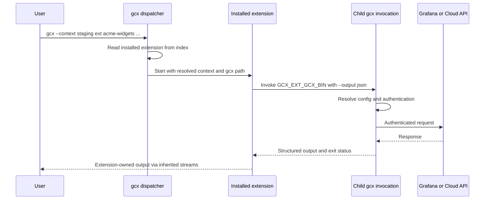

# RFC 003: Third-party extensions

## Summary

Add `gcx ext` to install, list, update, remove and run third-party programs. Each extension is a git repository containing a manifest and either a script or references to prebuilt binaries. gcx installs a repository snapshot, verifies any downloaded binary artifact, records the installation and invokes the program as a subprocess. Extensions that need Grafana or Cloud access call the invoking gcx binary, reusing its authentication and context resolution without exporting resolved credentials.

This design aims for a narrow scope: independently maintained extensions with no required registry or SDK. Authors can use any supported git host. The proposal includes inherited configuration selection, repository-contained scripts, checksummed binary downloads and extension-name reporting controlled by the existing usage-statistics setting. It is not a shipped capability; remaining validation is described below.

## Motivation

Extensions let authors ship functionality closely related to gcx that does not sit within its core feature set, such as an interactive TUI. They also let a company distribute a tool built around gcx to its staff without having to fork gcx.

The existing [command tree](../../cmd/gcx/root/command.go) and provider registration model cover built-in capabilities. An extension program needs a separate distribution and execution mechanism. The goals are:

- easy authoring
- support for the six native OS/architecture combinations gcx releases
- freedom to choose the repository and artifact hosts
- management of the extension through gcx itself

## Scope

The first version requires each extension to be a git repository. Users can install extensions from a repository URL or local checkout, list installed extensions, update them, remove them and run them. Each compiled extension declares the OS/architecture combinations it supports in its manifest; it does not have to support every platform gcx runs on. There is no extension SDK. Scripts are supported on Linux and macOS only; Windows requires a native executable.

The following are out of scope for v1 but may be considered in the future: standalone manifest URLs instead of git repositories, a central discovery index, search for Grafana-owned extensions, background updates, extension scaffolding, manifest generation and shell completion for extension names. Extension discovery through `gcx commands` and `gcx help-tree` is also out of scope.

The entire `gcx ext` command tree is experimental, including management commands and extension dispatch. Follow the [experimental-command conventions](../design/experimental-commands.md) for help text and stability metadata on every command. The subprocess design targets native gcx; `wasip1` support is outside v1 scope and that build does not register `ext`.

## User experience

All `ext` commands and extension-specific fields below are proposed.

### Install and run an extension

An author supplies a repository containing `gcx-extension.yaml`:

```bash
gcx ext install https://git.example.com/acme/gcx-ext-acme-widgets.git
gcx ext list
gcx --context staging ext acme-widgets sync ./widgets.yaml --dry-run
```

Installation presents the extension's name, version, repository, selected ref and resolved commit, plus its homepage when supplied, before asking for confirmation. For compiled extensions, the plan also shows the artifact URL and the SHA-256 checksum supplied by the author. Repository-contained scripts require no separate archive or author-provided checksum. The help and confirmation disclose the [shared responsibility model](#shared-responsibility-and-user-disclosures): the program is unaudited, runs with the user's permissions and is used at the user's own risk.

Install and update accept `--yes` for non-interactive approval, alongside `--force` and enabled `GCX_AUTO_APPROVE`. `--yes` is an explicit extension-command addition to the existing [confirmation convention](../design/safety.md), with the same approval semantics; it bypasses only the prompt, never verification or disclosures. Without approval, agent and non-interactive invocations fail with guidance to use `--yes`. Installation does not execute extension code or author-supplied install hooks.

`gcx ext list` shows the installed name, version, repository, tracked ref or pin, installed commit and description. `gcx ext --help` also lists installed extensions from the local index without running them.

The argument boundary is explicit: gcx global flags go before `ext`; every argument after the extension name belongs to the extension and is forwarded unchanged. In the example, gcx selects `staging`, while the extension interprets `sync`, the input path and `--dry-run`. gcx does not enforce dry-run behavior inside third-party code. Author guidance discourages reusing gcx global flag names because their meaning would depend on position.

### Update and remove

```bash
gcx ext update acme-widgets
gcx ext update --all
gcx ext uninstall acme-widgets
```

Installation follows the repository's default branch unless `--ref` selects a branch, tag or full commit ID:

```bash
gcx ext install https://git.example.com/acme/gcx-ext-acme-widgets.git --ref main
gcx ext install https://git.example.com/acme/gcx-ext-acme-widgets.git --ref v1.4.0
```

Branch installations record the selected branch and follow it on explicit update. A tag or full commit ID pins the installation to its resolved commit; update reports it as pinned and leaves it unchanged. gcx does not search for newer tags or releases. Changing the tracked branch, pin or repository requires an explicit install operation. The plan resolves its revision once and installs that exact commit after approval, even if the branch or tag moves meanwhile.

The fetched manifest must retain the installed extension name; a mismatch fails without changing the installation. If `acme-widgets` was installed from `https://git.example.com/acme/widgets.git`, installing another repository whose manifest also declares `acme-widgets` proposes a replacement. The plan shows the old and new repository, ref/commit and version before approval; it never silently changes which publisher future updates follow. Removal deletes the installed extension and its index entry.

### Develop locally

An author writes a program and manifest in a local git checkout, commits the manifest and script files, then installs from that checkout:

```bash
gcx ext install ./gcx-ext-acme-widgets
gcx ext acme-widgets --help
```

Installation copies a snapshot into gcx's extension directory rather than linking to the working tree. By default, a local install selects the checkout's current branch, or pins its commit if HEAD is detached. Updates read the recorded local repository and branch; they do not pull its remote automatically. Uncommitted script or manifest edits are not installed. Locally built binaries can use the `path` form described in the manifest section.

## Technical design

### Command placement and dispatch

We add a new command area: `ext`. CLI wiring belongs in `cmd/gcx/ext`. Manifest, installation, index and execution logic belong in `internal/ext`, following the [layer boundaries](../../CONSTITUTION.md#architecture-invariants).

The built-in subcommands are `install`, `list`, `uninstall` and `update`. Other first arguments are looked up as installed extension names. Installation rejects the reserved names `install`, `list`, `uninstall`, `update` and `help`, plus `search` and `scaffold` for possible future management commands. Reserving a name does not commit to implementing that command. There is no separate `run` verb and no top-level `gcx <extension-name>` dispatch.

The `ext` area prevents collisions with top-level gcx commands, but management verbs and extension names still share the namespace immediately below it. Once the feature is stable, the reserved set is fixed for the current major version: adding a management command must not make a previously valid extension invocation unreachable. For example, reserving `search` now permits a later `gcx ext search` without hiding an installed extension.

The extension command dispatcher is classified as `raw` under the [agent output protocol](../design/agent-mode.md). It forwards the extension's streams and exit status without wrapping its output or claiming that it obeys gcx's finite JSON contract. Management commands remain gcx-owned commands with their own declared output classes and normal structured errors. An extension need not match gcx's table formatting or color conventions.

Cancellation before launch uses gcx's cancellation status, 5. After launch, Ctrl+C interrupts the child and dispatch preserves its resulting exit status, including a successful exit if the child handles interruption and exits successfully. On Unix, termination by a signal maps to `128 + signal number`, so SIGINT termination returns 130. Dispatch must wait for the child to exit before releasing its execution lock, and must not replace the child result with gcx cancellation status 5. Windows interrupt delivery and process cleanup require platform validation.

Installed extensions appear in local extension help and listing, but not as individual entries in `gcx commands` or `gcx help-tree`. Agent mode is available to an extension through its environment; gcx cannot enforce its behavior. The [exit-code guide](../design/exit-codes.md) will need to document extension child statuses and distinguish them from gcx-owned failures before execution begins.

The constitution already uses “extension commands” to mean domain operations such as `acknowledge`. This proposal uses **third-party extension** for an external program. The dispatch grammar and terminology should be documented explicitly when the feature is accepted.

### Manifest

Each repository supplies `gcx-extension.yaml` at its root. `schemaVersion: 1` identifies the manifest format using an integer; `version` identifies the extension release. gcx rejects unsupported schema versions with a clear error before installing the extension. Names and descriptions are top-level fields, and there is no `kind` field. This is an installation document, not a Grafana resource for `gcx resources push`. `homepage` and `maxGCXVersion` are optional.

A compiled extension, for example one written in Go, publishes prebuilt archives and records their URLs and full SHA-256 digests in its manifest. Users do not need Go installed. The `platforms` list declares the supported OS/architecture combinations. Authors may list any nonempty subset of gcx's native targets; omitted combinations are unsupported. The following example supports only the three listed targets:

```yaml
schemaVersion: 1
name: acme-widgets
description: Manage Acme widget resources from gcx
version: 1.4.0
minGCXVersion: 1.8.0
maxGCXVersion: 1.12.0
homepage: https://git.example.com/acme/gcx-ext-acme-widgets
platforms:
  - selector: {os: linux, arch: amd64}
    url: https://downloads.example.com/acme-widgets/1.4.0/linux-amd64.tar.gz
    sha256: "<artifact-sha256>"
    bin: acme-widgets
  - selector: {os: darwin, arch: arm64}
    url: https://downloads.example.com/acme-widgets/1.4.0/darwin-arm64.tar.gz
    sha256: "<artifact-sha256>"
    bin: acme-widgets
  - selector: {os: windows, arch: amd64}
    url: https://downloads.example.com/acme-widgets/1.4.0/windows-amd64.zip
    sha256: "<artifact-sha256>"
    bin: acme-widgets.exe
```

The extension version is independent of the gcx version. `minGCXVersion` declares the minimum compatible gcx release. Optional `maxGCXVersion` declares the highest compatible release, allowing authors to limit execution when later gcx changes would break their extension. Both bounds are inclusive, use full semantic versions rather than range expressions, and are checked at installation and before every execution. A maximum below the minimum is invalid. Omitting the maximum imposes no upper bound. The illustrative versions are not promised release targets. The installed metadata retains both bounds so a gcx upgrade cannot bypass the compatibility check. If no platform row matches, installation fails with an error naming the current OS/architecture and listing the combinations declared in the manifest. There is no build-from-source fallback.

Each downloaded binary archive must have an author-provided checksum. Authors compute it from the exact published archive using `shasum -a 256 <archive>` on macOS or `sha256sum <archive>` on Linux. Different OS/architecture binaries normally need different archives and checksums.

For a local build, a platform row can use `path` instead of `url`, `sha256` and `bin`:

```yaml
platforms:
  - selector: {os: "*", arch: "*"}
    path: ./bin/acme-widgets
```

`path` is allowed only when installing from a local checkout. It copies an already-built executable from within that checkout, including an untracked build output; gcx does not run the build. Wildcard selectors are allowed for this local development case. Remote repositories must use checksummed downloads for compiled programs.

A manifest must specify exactly one of `script` or `platforms`; specifying both is an error. gcx runs the entry point directly rather than generating a shell command. On Linux and macOS, scripts must be executable and supply a shebang for an interpreter available on the user's machine. Windows supports native executable entry points only; `script` manifests are rejected there.

### Publish a script

Commit the script and its supporting files alongside `gcx-extension.yaml`. A complete manifest for a script that works on both Linux and macOS is:

```yaml
schemaVersion: 1
name: hello
description: List dashboards through gcx
version: 1.0.0
minGCXVersion: 1.8.0
script: ./hello.sh
```

Save this as `hello.sh`:

```sh
#!/bin/sh
exec "$GCX_EXT_GCX_BIN" resources get dashboards --output json
```

Make it executable, commit the files and push the repository to the author's chosen git host:

```bash
chmod +x hello.sh
git add gcx-extension.yaml hello.sh
git commit -m "add hello extension"
git push
```

The single `script` entry applies to Linux and macOS on both supported architectures. There is no archive, checksum or repeated platform table for repository-contained scripts. Authors must document interpreter and OS-specific dependencies; declaring a script does not make those dependencies portable. Supporting files come from the same installed commit, and scripts locate them relative to their own location because dispatch preserves the caller's working directory. User-facing author documentation must include this minimal recipe.

### Installation sources and local state

`gcx ext install <repository>` accepts an HTTPS or SSH git repository URL, or a path to a local git checkout. HTTPS URLs always identify repositories, with or without a `.git` suffix. There is no `--source-type` flag, standalone manifest URL or archive installation source. The user's installed `git` handles repository access and existing authentication, without a GitHub API dependency or required hosting service.

Remote git retrieval requires HTTPS certificate or SSH host identity verification; HTTP, `git://` and HTTPS-to-HTTP redirects are unsupported. Binary artifacts require HTTPS with certificate verification and no downgrade redirects, using gcx's shared HTTP infrastructure. The installer reads the manifest and script files from the selected commit rather than executing repository setup logic. It does not run builds, hooks or checkout filters, or initialise submodules; authors must commit the files needed by a script directly into the repository. Safe snapshot materialisation, including path and symlink containment, requires validation before release.

Source, artifact and redirect URLs containing embedded credentials are rejected before use, persistence or display. This includes HTTP user information, access tokens and presigned authentication parameters; errors must not echo the rejected URL. SSH usernames identify the remote account and are allowed, but embedded passwords are not. The index and install/list output contain credential-free locations only. Private git sources use the user's existing git authentication; v1 adds no URL-based credential storage.

The extension directory follows the [configuration directory convention](../../internal/config/loader.go), normally `~/.config/gcx/extensions/`, with a proposed `GCX_EXTENSIONS_DIR` override. Payloads live under `<name>/<version>/`. A single `index.json` records each extension's name, version, description, repository URL or absolute local checkout path, tracked branch or pinned revision, installed commit, executable path, gcx compatibility bounds and installation time. Local `path` installs are identified as local builds; their binary bytes are not claimed to be represented by the recorded commit.

Only install, update and uninstall change the index. Listing and execution read it instead of scanning PATH, walking extension directories or invoking programs for metadata. Versioned directories identify the current payload; retaining several runnable versions is not part of this proposal.

The installation pipeline resolves a repository revision, reads its manifest, validates compatibility and executable selection, presents the plan and obtains approval. It then stages the script snapshot, downloads and verifies the binary archive, or copies the declared local build, before recording the installation. Missing or mismatched checksums fail closed for downloaded artifacts. Repository-contained scripts use the selected commit and trusted retrieval instead of a separate archive checksum; this establishes neither publisher trust nor signature verification.

A failed installation must not create a runnable index entry, and a failed update must leave the previous installation runnable. A branch can advance without changing the manifest's version, so replacement must handle a new commit with the same version. Atomic payload replacement, concurrent index writes and extraction containment need the concrete validation described below.

Update, replacement install and uninstall reject an extension that is currently running through gcx, with an error asking the user to retry after it exits. Dispatch acquires a shared per-extension file lock before reading its installed entry and holds it until the child exits. Mutations require an exclusive lock; if it is busy, they fail without changing the installation. This permits concurrent executions without a process registry, using the existing cross-platform file-locking dependency. Lock files live outside replaceable payload directories and remain stable across uninstall/reinstall. Index writes still require separate serialization to prevent mutations of different extensions from losing each other's changes.

The running check covers invocations supervised by a live gcx dispatcher, not independently launched or detached descendants. A dispatcher crash can release its lock while a child survives; interruption and crash tests must establish the cleanup behavior before this protection is considered validated.

### Calling gcx from an extension

An extension reaches Grafana or Cloud by invoking the same gcx binary that launched it. This reuses the existing config, authentication and refresh behavior rather than introducing an extension credential API.

gcx launches the installed executable by its recorded path while preserving the caller's working directory. This keeps relative input paths such as `./widgets.yaml` meaningful and lets child gcx calls discover the same local `.gcx.yaml`. An extension that changes its own working directory must restore the invocation directory for callbacks that rely on local config discovery.

| Environment variable | Proposed value |
| --- | --- |
| `GCX_EXT_GCX_BIN` | Path to the invoking gcx executable |
| `GCX_EXT_NAME` | Installed name used for dispatch, which may differ from the executable name |
| `GCX_AGENT_MODE` | Agent mode resolved by the parent invocation |
| `GCX_CONTEXT` | Context name resolved by the parent invocation |
| `GCX_CONFIG` | Absolute path to an explicitly selected config file, when one was selected |

`GCX_CONTEXT` is a prerequisite, not an existing capability on main. Context selection follows explicit `--context`, then `GCX_CONTEXT`, then `current-context`. The parent passes its selected name to the extension; a child invocation can deliberately override it with `--context`. A missing selected context is an error, never a fallback to another target.

If the parent selected a file explicitly through `--config` or `GCX_CONFIG`, dispatch passes that selection through `GCX_CONFIG` as an absolute path. The parent's explicit flag takes precedence over its environment; an explicit child `--config` can override the inherited selection. Without an explicit file selection, dispatch leaves `GCX_CONFIG` unset and preserves normal system, user and local config layering. It must not turn the default user config path into an explicit selection that bypasses other layers.

Children inherit the parent's environment and invocation directory, then use ordinary gcx configuration loading and authentication refresh for each call. This preserves configuration selection, not a snapshot of the resolved destination or credentials. If the selected context's configuration is edited between calls, later calls see that edit; changing only `current-context` does not replace the inherited context name. Dispatch does not export resolved credentials or create a temporary config snapshot.

For example, a script can retrieve resources through the host:

```sh
"$GCX_EXT_GCX_BIN" resources get dashboards --output json
```

Authors must request `--output json` explicitly rather than relying on human or agent defaults. They must inspect stdout on nonzero exits too: a partial failure can emit a complete result document with per-item failures and exit 4. gcx-owned protocol behavior remains described in [DESIGN.md](../../DESIGN.md#dual-purpose-design).



This makes gcx's JSON outputs an integration surface. Existing envelopes vary by command. Authors can bound supported gcx releases with `minGCXVersion` and optional `maxGCXVersion`, but those declarations require author testing; they do not detect incompatible output changes automatically or establish a new compatibility guarantee.

### Trust and credentials

An installed extension runs with the user's permissions and inherits the parent's environment. gcx does not audit the program, sandbox it, enforce permissions declared in a manifest or verify publisher signatures. A checksum establishes that an artifact matches its manifest, not that the author is trustworthy.

“No credential handoff” means gcx adds no dedicated token-export mechanism. It is not credential isolation: inherited variables can already contain credentials, and a process with the user's permissions may access local configuration and other user-accessible secrets. Calling gcx is the supported integration contract, not a technical restriction preventing the program from making its own network requests.

An author who needs a raw credential for a separate SDK receives no new API for that in this design. A future credential mechanism would need its own justification and review.

### Shared responsibility and user disclosures

Third-party extensions are independently supplied software. Installing, listing or running one through gcx does not mean that Grafana or the gcx maintainers have reviewed, approved, endorsed or agreed to support its contents. The contents and behavior of a third-party extension, and the consequences of choosing to run it, are outside the responsibility of gcx maintainers. This boundary applies to repository-contained scripts, downloaded binaries and local builds alike.

| Party | Responsibility |
| --- | --- |
| Extension author | Own the extension's code, dependencies, behavior, documentation and support, including any telemetry it collects |
| User or operating organisation | Decide whether to trust the author and code, review what is installed or updated, choose the permissions and credentials available to it, and accept the consequences of running it, including through an agent or automation |
| gcx maintainers | Maintain the documented installer and dispatcher behavior, including transport checks, artifact verification, safe installation, context propagation and disclosures; these mechanisms do not make third-party code safe or transfer responsibility for its contents to gcx |

An extension can act with the user's local permissions and available API access. Users must understand that it can read or change files, access available secrets, make network requests and modify remote resources. Checksums establish artifact integrity; they do not establish safety or publisher trust. The responsibility boundary does not excuse defects in gcx's own installer or dispatcher.

Before the feature ships, publish a user-facing extension guide covering this model, the trust and credential boundaries, author support ownership, and the limits of gcx's checks. Link it from the normal user documentation navigation and `gcx ext --help`; an RFC alone is not sufficient disclosure. Both the guide and command help must state that users run third-party extensions at their own risk and that gcx maintainers are not responsible for their contents or the consequences of running them.

The CLI must surface the model at the points where users acquire or execute code:

- `gcx ext --help` and install/update help include the responsibility statement and a link to the user guide.
- Install and update plans identify the extension name, version and source and display the statement before approval. Updates repeat it because they introduce new code, even when the publisher is unchanged.
- Each `gcx ext <name>` invocation emits a brief notice identifying the third-party extension and the user's responsibility before starting the process. This is a diagnostic on stderr; stdout remains extension-owned output. It does not introduce an additional execution confirmation prompt.
- Notices remain visible in agent and non-interactive use. `--yes`, `--force` and `GCX_AUTO_APPROVE` bypass confirmation only; they do not suppress disclosure.

The install/update statement should use direct language, for example:

> This is a third-party extension. Grafana and the gcx maintainers do not review, endorse or support its contents and are not responsible for the consequences of running it. It runs with your permissions and available credentials. You are responsible for reviewing it and use it at your own risk.

The execution notice may be shorter while preserving the boundary, for example: `running third-party extension <name> (<version>) at your own risk; gcx does not review or support its contents`. gcx-owned notices use the shared diagnostic output facilities and must never be mixed into extension stdout or the structured results of management commands.

### Usage telemetry

gcx records `gcx ext <name>` through the existing [telemetry pipeline](../../internal/telemetry/event.go). A name is eligible only after it matches an installed index entry; unmatched text is discarded. Arguments and extension flag values are never recorded. Names are plain text so usage can be attributed to individual extensions.

Extension usage follows the existing [usage-statistics setting and precedence](../../internal/telemetry/telemetry.go), which is enabled by default. The existing opt-out, including `GCX_TELEMETRY=disabled` or `diagnostics.telemetry: disabled` in config, disables extension events as well as built-in command events. There is no separate extension-name opt-in or manifest-level opt-out. Disabled means no extension event is emitted, including a generic `gcx ext` event; the existing local-only `log` mode records exactly the event that would otherwise be sent, including the installed extension name, without sending it over the network.

A tradeoff: extension names could identify an organisation or internal workflow. Make this clear in extension author documentation. Users can prevent extension-name reporting by disabling usage statistics through the existing mechanism. Before release, update the telemetry policy, published usage-statistics documentation and first-run notice, including its revision for existing installations, to disclose name reporting. Authors may implement their own extension telemetry, but gcx cannot enforce its opt-out on arbitrary third-party code; user documentation must keep that boundary clear.

## Drawbacks

Authors need a git repository even for a single executable, and users need git installed. Compiled-extension authors maintain platform artifacts and checksums as well as the manifest. Script runtimes are additional user dependencies, and installation cannot promise cross-platform execution merely because a script needs no compilation. Users discover extensions through their authors rather than a central index.

Agents cannot discover individual extension capabilities through gcx's normal catalog, and gcx cannot guarantee their output, errors, safety or support ownership. Authors must document those behaviors and provide support for their extensions.

Parsing gcx JSON couples extensions to command outputs. Author testing and declared gcx version bounds provide limited protection; they do not detect future incompatibilities automatically, and an upper bound requires authors to publish an update before users can run the extension on newer gcx releases. Extension processes also retain the user's broad local permissions, and the proposed telemetry names can disclose organisational information.

## Rationale and alternatives

We compared the gh, kubectl/krew, Cargo, Docker and Helm extension models. We took a declarative platform manifest and calling the host CLI to get data from the system. We left out a separate package manager and author-supplied installation scripts. Requiring a git repository gives scripts and compiled programs one source and update model while letting authors choose their host.

Flat `gcx <name>` dispatch would introduce collisions with future built-in areas and conflict with the [closed top-level grammar](../../CONSTITUTION.md#cli-grammar). Keeping extensions under `ext` makes ownership visible. A separate `gcx ext run <name>` would avoid fallback dispatch but adds another verb; the proposed contract instead reserves management names and forwards the remaining arguments unchanged.

In-process plugins would couple extension authors to gcx's build and runtime. Separate programs preserve language independence and fit the native release matrix. A build-from-source fallback would introduce toolchain detection and a second installation path, so an unsupported platform fails explicitly.

A credential-resolution command, permission manifest and language SDK would add another authentication interface when calling gcx already serves the motivating cases. Scaffolding and generated manifests may reduce author effort later, but neither is necessary to establish the execution contract.

### Alternative: standalone manifests and archives

Installation could also accept a manifest URL or local archive. This would avoid requiring a repository for a single executable and let authors distribute entirely from a static host. It would add source classification and different update semantics, and remotely distributed scripts would need their own checksummed packages.

V1 uses git repositories to keep source resolution and updates consistent and let script authors publish their files directly. Binary artifact downloads remain necessary, as do safe installation, atomic updates, identity checks and the execution/configuration contracts.

## Validation

Validation must exercise the following contracts before release:

| Contract | Required evidence |
| --- | --- |
| Independently owned use case | A real partner or customer authors and maintains an extension outside gcx, exercising authoring, installation, updates and authenticated calls |
| Manifest and platform selection | Table-driven tests for integer schema versions, rejection of unsupported schema versions, required and optional fields, reserved names, inclusive minimum/maximum gcx versions at install and execution, omitted maximum, invalid bounds, each native platform, valid manifests supporting only a subset of targets, local wildcard rows, rejection of omitted targets with an error listing supported combinations, and rejection of manifests with both `script` and `platforms` |
| Hosting independence | Install from a local git checkout and non-GitHub HTTPS/SSH repositories, including HTTPS URLs without `.git`; reject standalone manifests, archives and non-repository directories |
| Repository revisions | Branch updates follow the recorded branch; tags and full commit IDs remain pinned; install the approved commit even if a ref moves; local installs use committed files and local branch updates without pulling a remote; preserve script executable permissions and supporting files |
| Source trust | Reject HTTP and `git://` transports and HTTPS-to-HTTP redirects; reject credential-bearing source, artifact and redirect URLs without persisting or echoing secrets; verify HTTPS certificates and SSH host identity |
| Artifact integrity | Install the documented script directly from a repository without an archive checksum; verify author-provided checksums for binary downloads; missing or incorrect checksums and remote binary `path` entries fail without a runnable registration; archive/repository paths and symlinks cannot escape the installation directory; no repository hooks, filters or submodules execute during installation |
| Installation state | Failed updates and manifest-name mismatches preserve existing installations, including replacement by a new commit with the same version; explicit source replacement presents both sources for approval; simultaneous mutations do not corrupt or lose index entries; concurrent executions are allowed, while update/replacement/uninstall reject active invocations without changing state; exercise dispatch/mutation races and stable locks across reinstall |
| Approval | Interactive decline returns cancellation; `--yes`, `--force` and enabled `GCX_AUTO_APPROVE` permit non-interactive approval; agent/non-interactive use without approval fails clearly; verification and disclosures remain active; no extension code runs during install |
| Responsibility disclosures | The user guide and help contain the responsibility model; install/update plans and each execution show the required notice, including agent and auto-approved paths; diagnostics stay on stderr without changing structured or extension stdout |
| Experimental status | Every command in the `ext` tree has experimental help text and stability metadata |
| Argument and process behavior | Global flags before `ext`, verbatim child arguments, preserved working directory and relative inputs, reserved-name handling, inherited streams, nonzero child exits, pre-launch cancellation status 5, child results after interruption and Unix signal-status mapping; new management commands cannot hide previously valid extension names |
| Context and authentication | Verify flag/environment/current-context precedence, absolute explicit-file propagation, preserved layering and local config discovery, missing-context failure, auth refresh and resolved agent mode; changing the selected context between child calls is observed, while changing only `current-context` does not redirect them |
| Output consumption | An example extension explicitly requests JSON and handles a structured partial failure on stdout despite exit 4 |
| Telemetry | Enabled usage statistics include installed names only; the existing opt-out suppresses all extension events, local-only log mode records the exact would-be event without sending it, and unmatched names and extension arguments cannot reach any telemetry field; the updated notice reaches existing installations |
| Portability | Compiled execution across all six native targets, Unix shebang execution and missing-interpreter failures, Windows rejection of script entry points, dispatcher interruption/crash cleanup |

Implementation can proceed in small slices: manifest validation, directory/index management, repository retrieval, script snapshots, binary artifacts, update/removal and CLI dispatch. Context propagation must be ready before end-to-end dispatch is considered correct. Command wiring must include output metadata, help, user and author documentation, and tests for the final process boundary. Architecture and package-map documentation should change with the implementation they describe.

## Unresolved questions

- **Manifest and install state:** finalize valid extension names. Establish atomic update and index-write behavior through failure and concurrency tests, including execution/mutation races, same-version commit changes and safe repository snapshot materialisation.
- **Process portability:** validate Windows interruption and child-result propagation, Unix signal-status mapping, and child cleanup after dispatcher failure.

These are acceptance gaps in the proposed contract; the design choices above do not establish that the implementation satisfies them.

## Future possibilities

If adoption justifies them, follow-up proposals could add a discovery index, search for Grafana-owned extensions, an author scaffold, generated manifests from release output, a small helper for calling gcx and parsing results, or a metadata handshake for agent discovery. None is a dependency of the initial extension mechanism.

## Terminology

- **Third-party extension:** an independently distributed executable or script installed and invoked through `gcx ext`.
- **Manifest:** the author's installation document describing identity, compatibility and executable selection.
- **Installation index:** gcx's local record of installed extensions and their sources; not a public discovery catalog.
- **Install source:** the git repository URL or local checkout path, with the tracked branch or pinned revision recorded for later updates.
- **Raw dispatch:** passing through extension-owned output and process status without claiming gcx's finite-output contract.
