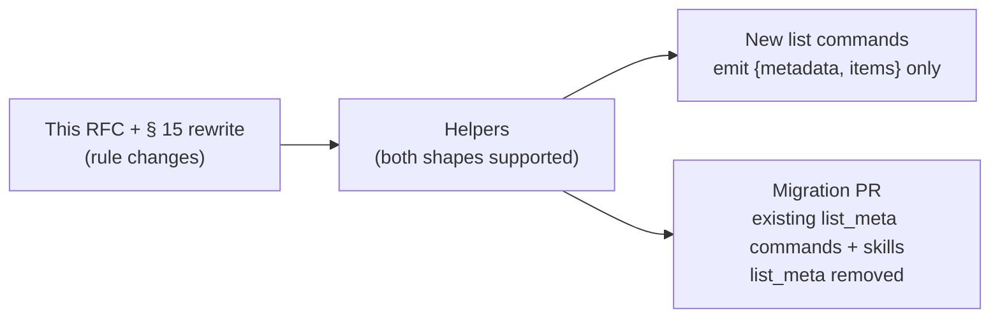

# RFC 030: List Output Envelope

**Created**: 2026-10-30
**Status**: proposed
**Supersedes**: the `list_meta` payload signal in [`docs/design/output.md` § 15](../design/output.md#15-list-output-contract) (kept as deprecated in § 15.6)

## Summary

Every list command's structured output (`-o json`, `-o yaml`, `-o agents`)
becomes one fixed envelope:

```json
{"type": "gcx.list", "schema_version": "1", "metadata": {...}, "items": [...]}
```

`metadata` is always present and always has the same keys, so an agent reads
the truncation, limit, count and filter state of any list from one place,
without knowing which command produced it and without reading stderr. `items`
is always an array of objects. Table, wide and text output do not change.

The envelope replaces the `list_meta` sibling key defined by § 15.2. New list
commands adopt it immediately; existing `list_meta` producers keep their
current shape until a separate migration moves them and removes `list_meta`.

## Motivation

gcx list output has no common shape. Within the SQL datasources alone, six
discovery commands produce three:

```jsonc
// postgres, mysql, mssql: raw query result, positional rows
{"columns": [{"name": "schema", "type": "string"}, ...], "rows": [["public", "events", "BASE TABLE"]]}

// clickhouse, bigquery: bare array (no room for metadata)
[{"database": "default", "name": "events", "engine": "MergeTree"}]

// athena: envelope of strings
{"items": ["events", "orders"]}
```

The current truncation contract in § 15 adds a `list_meta` key beside the
items when, and only when, the page was truncated. That fixed silent
truncation for the commands that adopted it, but leaves three problems:

1. **The payload key varies.** `datasources list` uses `datasources`, `docs
   search` and Prometheus search use their own keys, and grafana/gcx#1411
   proposes `items` for about 28 more commands. An agent has to know each
   command's key before it can find the items.
2. **Absence is the signal.** "No `list_meta` means complete" works only if
   the reader knows the command participates in the contract. A command that
   never adopted it looks identical to a complete result.
3. **It says nothing about a complete list.** A complete list carries no
   limit, count or filter information, so an agent cannot tell whether
   `--limit` was applied, what was filtered, or how many items exist without
   a second call.

Stderr does not close the gap. Agents routinely run `gcx ... -o json
2>/dev/null | jq ...`, and the [agent output contract](../../CONSTITUTION.md)
already says an agent never needs to parse both streams to understand the
outcome.

The immediate driver is grafana/gcx#1670, which adds `--filter` and
`--limit` to the SQL discovery commands. Those commands need a truncation
signal now; shipping them on `list_meta` would change their shape twice.

## Scope

In scope:

- The structured-output envelope for commands that return a list of items.
- The `metadata` schema, its population rules, and the paired stderr hint.
- `--json` field selection, `--jq` and field discovery on the envelope.
- The transition from `list_meta`, including which commands move when.

Out of scope:

- Single-object output and query results (time series, log lines, query
  data frames). A meta/payload split for those is a separate proposal.
- Default `--limit` values. Each command keeps its current default; making
  defaults consistent is a separate step of grafana/gcx#1031.
- Pagination. A command that fetches a page still reports it through
  `metadata`; this RFC does not add cursors.
- Raw passthrough output (`gcx api`), which keeps the server's shape.

## User experience

An agent lists PostgreSQL tables in a large schema, narrowed to names
containing `events`:

```console
$ gcx datasources postgres list-tables --schema public --filter events -o json
```

```json
{
  "type": "gcx.list",
  "schema_version": "1",
  "metadata": {
    "truncated": true,
    "limits": {"requested": 500, "hardcap": null},
    "counts": {"returned": 500, "total": null},
    "filters": {
      "applied": {"schema": "public", "filter": "events"},
      "available": ["--filter", "--schema"]
    },
    "next": "gcx datasources postgres list-tables --schema public --filter events --limit 1000"
  },
  "items": [
    {"schema": "public", "name": "events", "type": "BASE TABLE"},
    {"schema": "public", "name": "events_2026_01", "type": "BASE TABLE"}
  ]
}
```

The agent sees that the list was cut at the 500 it asked for, that the total
is unknown, which filters were applied, which flags could narrow it further,
and the exact command that fetches more. It can tighten `--filter`, or run
`next`.

When the result is complete, the shape is the same:

```json
{
  "type": "gcx.list",
  "schema_version": "1",
  "metadata": {
    "truncated": false,
    "limits": {"requested": 500, "hardcap": null},
    "counts": {"returned": 42, "total": 42},
    "filters": {"applied": {"schema": "public"}, "available": ["--filter", "--schema"]},
    "next": null
  },
  "items": [ ... ]
}
```

The same jq paths work on every list command:

```bash
gcx <any list command> -o json | jq '.items[].name'
gcx <any list command> -o json | jq '.metadata.truncated'
```

A human at a terminal sees the usual table on stdout and, when truncated, one
hint on stderr built from the same metadata:

```text
hint: showing first 500; more results are available. Narrow with --filter, or see more with: gcx datasources postgres list-tables --schema public --filter events --limit 1000
```

## Technical design

### Envelope

| Key | Type | Meaning |
|---|---|---|
| `type` | string | Always `gcx.list`. |
| `schema_version` | string | `"1"` for the shape in this RFC. |
| `metadata` | object | List state; see below. Always present. |
| `items` | array of objects | The listed items. Always present; `[]` when empty. |

No other top-level keys are allowed. Information a command used to put beside
its items (for example Prometheus search `warnings`) moves into `metadata`
(see [Unresolved questions](#unresolved-questions)).

`type` and `schema_version` are the discriminators the
[agent output contract](../../CONSTITUTION.md) requires of every gcx-owned
envelope introduced under it, and follow the existing `gcx.<name>` / `"1"`
convention used by mutation results and spill receipts. One `type` covers all
lists: consumers dispatch on the shape, and what an item is follows from the
command they ran.

### `metadata`

Every key is always present. `null` means unknown or not applicable. There
are no sentinel values (`-1`, `""`): a sentinel survives arithmetic and
comparison as if it were real, and `null` does not.

| Key | Type | Meaning |
|---|---|---|
| `truncated` | bool | `true` when items matching the request were left out. |
| `limits.requested` | int or null | The effective `--limit`. `null` when unbounded (`--limit 0`). |
| `limits.hardcap` | int or null | A gcx safety cap that bounded the fetch, set only when that cap, not `--limit`, was the bound. |
| `counts.returned` | int | Number of items in `items`. |
| `counts.total` | int or null | Size of the complete set, only when actually observed. Never estimated. |
| `filters.applied` | object | Filter flags the user set, by flag name without dashes, with their values. `{}` when none. |
| `filters.available` | array of strings | Flags that narrow this list, with dashes. `[]` when the command has none. |
| `next` | string or null | A runnable command that retrieves more. `null` when not truncated, or when `hardcap` was the bound. |

Population rules carry over from § 15 unchanged in substance:

- **`total` is observed, never guessed.** A fully fetched source reports it.
  A paginated or over-fetched source reports `null` unless pagination ended
  while trimming to the bound.
- **`next` is derived from the real invocation.** It is built from the
  process argv with any prior `--limit` removed, so the user's filters
  survive. With a known total it suggests `--limit 0`; with an unknown total
  it suggests double the current limit; on a hardcap page it is `null`,
  because no `--limit` can beat the cap.
- **`hardcap` wins over `requested`.** When the cap was the bound, the page
  is truncated, `next` is `null`, and the hint tells the reader to narrow
  with filters.
- **`filters` comes from the command's declared filter flags.** A command
  names its filter flags once; `applied` lists those the user changed and
  `available` lists all of them. Non-filter flags (output, datasource,
  context) never appear.

### Shared helpers

The envelope is produced by one typed helper in `internal/output` (building
on `cmdio.ListPage` / `cmdio.EncodeList` proposed in grafana/gcx#1411). The
names below are provisional; the contract is the output, not the Go API:

```go
page := cmdio.NewListPage(items, cmdio.ListState{
    Limit:       opts.Limit,
    Total:       total,          // *int; nil when unknown
    Truncated:   truncated,
    HardCap:     0,              // set only when a safety cap bound the fetch
    FilterFlags: []string{"filter", "schema"},
}, cmd.Flags(), os.Args)

if err := opts.IO.EncodeList(cmd.OutOrStdout(), page); err != nil { ... }
cmdio.EmitListTruncationHint(cmd.ErrOrStderr(), page.Metadata)
```

The existing constructors keep their roles and now return list state for the
page rather than a `*ListMeta`:

| Source shape | Constructor | `total` |
|---|---|---|
| Fully fetched | `TruncateCompleteList(items, limit)` | observed |
| Paginated, server reports more pages | `PagedListMeta(returned, limit, serverHasMore, safetyCap)` | `null` |
| Paginated or SQL, no more-pages signal | request `limit+1`, then `TruncatePagedList(items, limit)` | `null` |

`EncodeList` writes the envelope for `json`, `yaml` and `agents`, and the bare
`items` for table, wide and text codecs, so human output is unchanged.

The stderr hint is derived from `metadata` only, so the hint and the payload
cannot disagree. When `filters.available` is non-empty the hint names those
flags before suggesting `next`.

### Field selection and discovery

The envelope is recognized by its Go type (the helper's page value), not by
key names on arbitrary maps. `{metadata, items}` is also the Kubernetes List
shape, and raw passthrough output such as `gcx api` must keep whole-object
behavior.

- `--json a,b` selects fields inside each item and keeps `type`,
  `schema_version` and `metadata` unchanged.
- `--jq` runs on the whole envelope.
- `--json list` / `--json ?` discovery samples the first item and never lists
  `metadata.*`, `type` or `schema_version`. An empty list falls back to the
  item type's fields.

### Transition from `list_meta`



1. **Rule.** § 15 is rewritten to this design. New list commands, and list
   commands whose output shape changes for other reasons, must use the
   envelope. `list_meta` is deprecated.
2. **Helpers.** The envelope helpers land beside the `list_meta` helpers.
   Existing commands keep emitting `list_meta`; nothing breaks.
3. **New commands.** The grafana/gcx#1670 SQL discovery commands (BigQuery,
   PostgreSQL, MySQL, MSSQL, ClickHouse, Athena) are the first adopters.
4. **Migration.** One change moves every remaining `list_meta` producer and
   the bundled skills that document `list_meta`, then deletes `list_meta`
   support. That change is breaking for those commands and is marked as such
   in its commit and the changelog. grafana/gcx#1411 rebases onto this design
   and becomes part of, or precedes, that migration.

Commands emitting `list_meta` today: `datasources list`, `docs search`,
`metrics list`, `frontend apps list`, `fleet collectors list`, `irm oncall
alert-groups list`, `synthetic-monitoring suggestions list`, `agento11y rules
list-scores`, the three `datasources prometheus search-*` commands, and
`datasources tempo baseline` (also reached as `traces baseline`).

### Compatibility

The envelope changes the JSON and YAML shape of every command it reaches.
[§ 1.1](../design/output.md#11-built-in-codecs) describes json and yaml as
serializing the command's value without an envelope; it gains an explicit
exception for list envelopes. The CONSTITUTION's frozen surface covers
command paths, flags and positional syntax, not payload shape, so no
CONSTITUTION change is needed; the break is a maintainer decision recorded
by accepting this RFC.

For the first adopters the shape change is a side effect of work already
changing those commands: BigQuery and ClickHouse move from a bare array,
PostgreSQL, MySQL and MSSQL from `{columns, rows}`, and Athena from string
items to `{"name": ...}` objects.

## Drawbacks

- Every adopting command has a one-time breaking change in structured output.
  Scripts using `.[]` or a command-specific key must change to `.items[]`.
- A complete list now carries a `metadata` block that adds a few hundred
  bytes per call.
- Two list shapes coexist until the migration lands. The rule in § 15 says
  which applies, but readers may meet both in that window.
- The `metadata` name matches Kubernetes List metadata but not its contents.
  A Kubernetes-aware reader may expect `resourceVersion` or a `continue`
  token there.

## Rationale and alternatives

- **Keep `list_meta` (§ 15.2 as written).** No migration cost, but the
  payload key stays per-command, complete lists stay silent, and absence
  remains the signal. Those are the problems this RFC exists to fix.
- **`{"items": [...], "list_meta": {...}}` (grafana/gcx#1411).** Fixes the
  payload key but keeps metadata optional and absence-based. Always-present
  `metadata` costs little more and removes the need to know whether a command
  participates.
- **Omit unknown keys instead of `null`.** Smaller output, but the reader
  cannot distinguish "unknown" from "this version does not report it", and
  the shape again varies with the data.
- **Sentinels (`total: -1`, `next: ""`).** Fixed shape without nullable
  types, but `total - returned` and `total > 100` give wrong answers silently.
- **`continue` instead of `next`.** Matches § 15's current field, but in
  Kubernetes `metadata.continue` is an opaque token to send back. Ours is a
  command to run; a different name prevents that misuse.
- **Flat `metadata` (`returned`, `total`, `cap` side by side).** Shorter, but
  mixes what the caller asked for with what came back. Grouping `limits` and
  `counts` keeps each question in one place.
- **Per-command `type` values (`gcx.postgres.tables`).** More specific, but
  the shape is identical across commands and consumers already know which
  command they ran.
- **Recognize envelopes by key names.** Would let dynamic maps opt in, but
  `{metadata, items}` collides with Kubernetes List responses passed through
  unchanged.

## Prior art

- **Kubernetes List objects** (`apiVersion`, `kind`, `metadata`, `items`):
  the top-level split between list metadata and items, already familiar from
  `gcx resources get`. This design departs from it in `next` being a command,
  not a token.
- **gcx mutation results and spill receipts:** the `type` / `schema_version`
  discriminator convention.
- **[`docs/design/output.md` § 15](../design/output.md#15-list-output-contract):**
  the truncation rules (observed totals, argv-derived continuation, honest
  caps), which this RFC keeps and relocates into `metadata`.

## Unresolved questions

1. **Extra top-level keys in existing producers.** The Prometheus
   `search-*` commands return `warnings` beside their results, and `tempo
   baseline` returns the seed trace's profile (`seedTraceID`, `query`, span
   and service counts) beside its `candidates`. Diagnostics such as warnings
   fit in `metadata` (for example `metadata.warnings`, always present as
   `[]`). Data that describes the request rather than the list, such as the
   baseline seed, has no obvious home there. Resolve when the migration
   change audits each producer: either `metadata` gains a command-specific
   `context` object, or such commands are treated as single-object results
   that contain a list.
2. **`filters.applied` value types.** Repeated or map-valued filter flags
   (`--label k=v` given twice) need a representation. Proposal: the flag's
   parsed value (string, array or object). Resolve with the first command
   that has one.
3. **Unit of counting.** Commands whose items nest (alert rule groups
   containing rules) must state what `counts` and `--limit` count. The
   migration change settles this per command, as § 15 already requires.

## Future possibilities

- The same metadata/payload split for single-object and query outputs.
- Consistent default `--limit` values across list commands (grafana/gcx#1031,
  stage 2).
- A JSON Schema for `gcx.list` v1 published with the command catalog.

## Terminology

- **List envelope:** the `{type, schema_version, metadata, items}` object a
  list command writes in structured formats.
- **Hardcap:** a gcx-side safety cap on how many items a command fetches,
  independent of `--limit`; raising `--limit` cannot exceed it.
- **Observed total:** a total the command counted from a complete fetch or a
  drained pagination, as opposed to an estimate.
- **Filter flag:** a flag that narrows which items match, as declared by the
  command (for example `--filter`, `--schema`).
